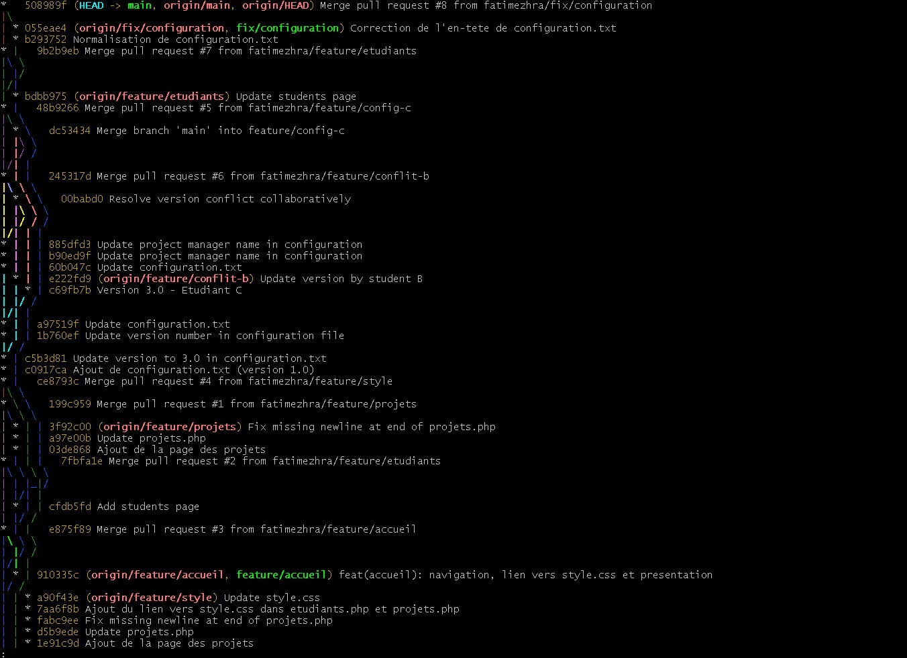
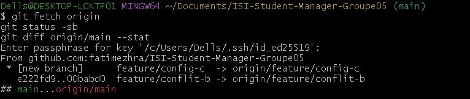
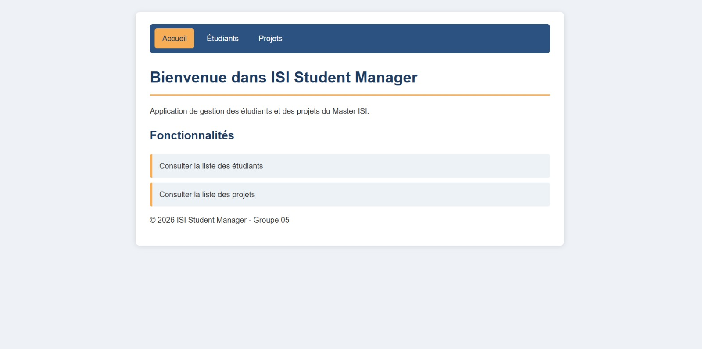
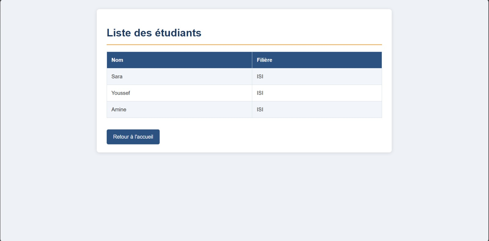
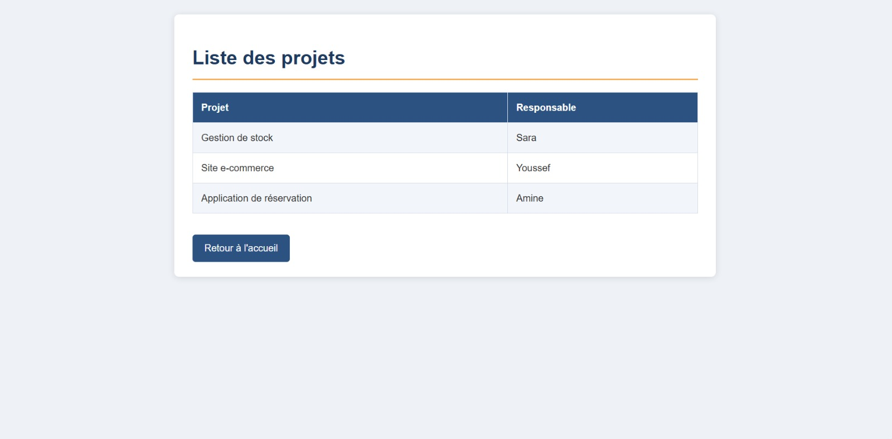

# ISI Student Manager – Groupe 05

Application web de gestion des étudiants et des projets, développée en équipe avec Git et GitHub (branches, Pull Requests, relectures croisées, résolution de conflits).

Université Cadi Ayyad – Faculté des Sciences Semlalia, Marrakech – Master ISI, S1 – Méthodologies de développement et Ateliers en PHP.

Dépôt : https://github.com/fatimezhra/ISI-Student-Manager-Groupe05

## Membres du groupe

| Rôle | Membre | Compte GitHub | Branche | Contribution |
|------|--------|---------------|---------|--------------|
| A | Khalil Fatima Ezzahra | fatimezhra | feature/accueil | Propriétaire du dépôt, page d'accueil, configuration, intégration |
| B | Zainab Zahid | zainab20zahid-hash | feature/etudiants | Page des étudiants, version 2.0|
| C | Fatima Ezzahra Baali | fatimazahrabaali | feature/projets | Page des projets, version 3.0 (conflit) |
| D | Aziza Halmaouy | aziza-halmaouy | feature/style | Mise en forme (style.css) |

## Prérequis

- Git
- PHP 8.0 ou supérieur (ou XAMPP / WAMP)
- Un navigateur web
- Une clé SSH configurée sur GitHub (ou utiliser le clonage HTTPS)

## Installation

```bash
git clone git@github.com:fatimezhra/ISI-Student-Manager-Groupe05.git
cd ISI-Student-Manager-Groupe05
```

Clonage en HTTPS si SSH n'est pas configuré :

```bash
git clone https://github.com/fatimezhra/ISI-Student-Manager-Groupe05.git
```

## Exécution

Depuis le dossier du projet :

```bash
php -S localhost:8000
```

Puis ouvrir dans le navigateur :

| Page | URL |
|------|-----|
| Accueil | http://localhost:8000/index.php |
| Liste des étudiants | http://localhost:8000/etudiants.php |
| Liste des projets | http://localhost:8000/projets.php |

Avec XAMPP ou WAMP : copier le dossier dans `htdocs` (XAMPP) ou `www` (WAMP), puis ouvrir http://localhost/ISI-Student-Manager-Groupe05/.

Pour arrêter le serveur : `Ctrl + C` dans le terminal.

## Structure du projet

| Fichier | Rôle |
|---------|------|
| index.php | Page d'accueil et navigation |
| etudiants.php | Liste des étudiants (nom, filière) |
| projets.php | Liste des projets (projet, responsable) |
| style.css | Mise en forme commune : navigation, tableaux |
| configuration.txt | Informations du projet : nom, version, responsable |
| images/ | Captures d'écran de l'application et de l'historique Git |
| README.md | Documentation du projet |

## Workflow Git de l'équipe

1. Ne jamais committer directement sur `main`.
2. Créer une branche par tâche : `feature/...` pour une fonctionnalité, `fix/...` pour une correction.
3. Pousser la branche et ouvrir une Pull Request vers `main`.
4. Faire relire la Pull Request par un autre membre (commentaire dans Files changed, puis Submit review).
5. Fusionner, puis mettre à jour son dépôt local :

```bash
git switch main
git pull origin main
```

En cas de conflit : fusionner `main` dans sa branche, résoudre les marqueurs `<<<<<<<` / `>>>>>>>`, puis committer et pousser.

## Exercice 7 : Pull Requests et revue de code

Chaque membre a publié sa branche et ouvert une Pull Request vers `main`. La relecture s'est faite en chaîne (A → B → C → D → A) : chaque Pull Request a reçu au moins un commentaire technique d'un autre membre dans l'onglet Files changed avant d'être fusionnée. Les PR #1 à #4 ont été fusionnées, puis chaque membre a mis à jour son `main` local avec `git pull origin main`.

### Intérêt d'une Pull Request par rapport à un push direct sur main

- **Relecture avant intégration** : un autre membre vérifie le code et détecte erreurs et oublis avant qu'ils n'atteignent `main`.
- **Branche principale stable** : seul du code validé est fusionné dans `main`.
- **Traçabilité** : chaque PR conserve la discussion, l'auteur, le relecteur et la date de fusion.
- **Contrôles automatiques** : la PR permet d'exécuter des analyses (par exemple SonarQube, visible sur nos PR) avant la fusion.
- **Collaboration** : on discute et on corrige avant la fusion, sans écraser le travail des autres.
- **Historique lisible** : les merges regroupent les commits d'une même fonctionnalité dans `git log --graph`.

Un push direct sur `main` n'offre aucune de ces garanties : une erreur est publiée immédiatement pour toute l'équipe.

## Exercice 8 : Conflit de fusion contrôlé

Le fichier `configuration.txt` a été publié sur `main` avec la ligne `Version : 1.0`. Deux membres ont ensuite modifié **la même ligne** sur deux branches différentes :

| Membre | Branche | Ligne modifiée |
|--------|---------|----------------|
| B | feature/conflit-b | `Version : 2.0 - Etudiant B` |
| C | feature/config-c | `Version : 3.0 - Etudiant C` |

Lors de la fusion de `main` dans une branche, Git a signalé un conflit sur `configuration.txt` et a inséré les marqueurs `<<<<<<<`, `=======` et `>>>>>>>`. Le conflit a été résolu en gardant une version commune, puis committé et poussé :

    Version : 3.0 - Version collaborative

Les Pull Requests #5 (C) et #6 (B) ont été relues et fusionnées. Une dernière Pull Request (`fix/configuration`) a normalisé le fichier (en-tête sur une seule ligne, sans espaces superflus).

Résultat final de `configuration.txt` :

    # configuration.txt
    Nom du projet : ISI Student Manager
    Version : 3.0 - Version collaborative
    Responsable : Groupe ISI

> Remarque : le fichier initial `configuration.txt` a été publié directement sur `main`, comme l'exige l'énoncé de l'exercice 8. Certaines modifications de ce fichier ont aussi été faites directement sur `main` via l'interface GitHub.

## Historique des commits et branches

```bash
git log --graph --oneline --all --decorate
git branch -a
```

Sur GitHub : onglet Insights, puis Network.


### Historique graphique



### Liste des branches



## Vérification de main et de l'application

### 1. main est à jour

```bash
git checkout main
git pull origin main
git status
```

Résultat attendu : `Your branch is up to date with 'origin/main'` et `nothing to commit, working tree clean`.

### 2. L'application fonctionne

```bash
php -S localhost:8000
```

| Page | URL | Résultat |
|------|-----|----------|
| Accueil | http://localhost:8000/index.php | Affichée avec navigation et style |
| Étudiants | http://localhost:8000/etudiants.php | Tableau affiché |
| Projets | http://localhost:8000/projets.php | Tableau affiché |

## Captures d'écran

### Page d'accueil



### Liste des étudiants



### Liste des projets



## Tâches réalisées

- [x] Initialisation du dépôt et page d'accueil
- [x] Page des étudiants (etudiants.php)
- [x] Mise en forme avec style.css (tableaux et navigation)
- [x] Page des projets (projets.php)
- [x] Fichier configuration.txt en version 3.0 – Version collaborative
- [x] Résolution de conflits entre branches
- [x] Pull Requests relues et fusionnées sur main
- [x] Historique graphique des commits et des branches
- [x] Vérification de main et de l'application
- [x] Documentation (README.md)
 
